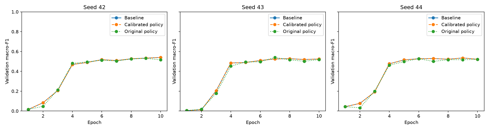
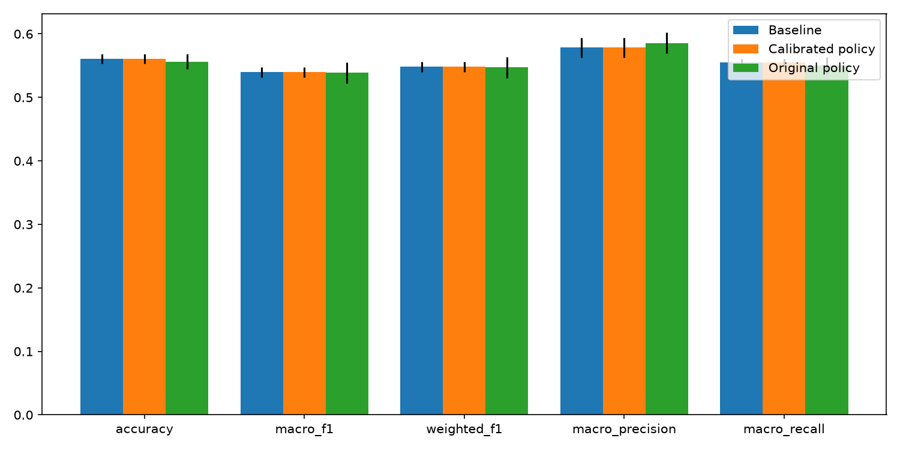

# Q-ARMOR: completed local archive-sample study

This report is generated from the recorded calibration and completed training runs. It does not describe full-dataset or live packet-to-alert performance.

## Fixed experiment protocol

The 34-class sample contains 66,342 training rows and 16,586 rows in each holdout split. Train-only balancing produces 34,000 rows (1,000 per class); every row is used each epoch. Consequently, calculated ordinary balanced class weights are uniform before adaptive scaling. The unchanged CNN/LSTM/attention model trains for 10 epochs per method and seed. Calibration uses seeds 101–103, five warmup epochs and paired one-epoch probes. Baseline/proposed use fresh initializations for seeds 42–44 with identical per-seed preprocessing, sample orders, budgets and initialization. Adam uses learning rate 0.0005 and clipnorm 1.

The validation split has two fixed stratified halves (seed 2026). One fits calibration; the other audits calibration and supplies ablation feedback/checkpoint selection. The game configuration and training budget were frozen before the new test evaluations. The test split was previously used for exploratory runs, so it is not a never-inspected external holdout.

## Three-seed results

| Metric | Baseline mean ± SD | Proposed mean ± SD | Paired difference mean ± SD |
|---|---:|---:|---:|
| accuracy | 0.56083 ± 0.00789 | 0.56083 ± 0.00789 | 0.00000 ± 0.00000 |
| macro_f1 | 0.53952 ± 0.00765 | 0.53952 ± 0.00765 | 0.00000 ± 0.00000 |
| weighted_f1 | 0.54812 ± 0.00810 | 0.54812 ± 0.00810 | 0.00000 ± 0.00000 |
| macro_precision | 0.57832 ± 0.01549 | 0.57832 ± 0.01549 | 0.00000 ± 0.00000 |
| macro_recall | 0.55474 ± 0.00638 | 0.55474 ± 0.00638 | 0.00000 ± 0.00000 |

SD is sample standard deviation over three seeds. These descriptive estimates have substantial uncertainty; a positive mean difference alone is not evidence of statistical significance.

## Seven preselected classes

| Class | Baseline F1 mean ± SD | Proposed F1 mean ± SD |
|---|---:|---:|
| Backdoor_Malware | 0.18286 ± 0.03385 | 0.18286 ± 0.03385 |
| BrowserHijacking | 0.32632 ± 0.01839 | 0.32632 ± 0.01839 |
| CommandInjection | 0.37031 ± 0.00344 | 0.37031 ± 0.00344 |
| SqlInjection | 0.25439 ± 0.01974 | 0.25439 ± 0.01974 |
| Uploading_Attack | 0.18992 ± 0.00616 | 0.18992 ± 0.00616 |
| VulnerabilityScan | 0.25273 ± 0.01506 | 0.25273 ± 0.01506 |
| XSS | 0.09423 ± 0.06457 | 0.09423 ± 0.06457 |

These seven classes were specified by the existing project before this study; they were not selected by test performance.

## Actions and learning curves

| Seed | Method | Best validation epoch | Best validation macro-F1 | Final validation macro-F1 | Applied reweighting decisions |
|---|---|---:|---:|---:|---:|
| 42 | baseline | 10 | 0.54019 | 0.54019 | 0 (0 followed by training) |
| 42 | proposed | 10 | 0.54019 | 0.54019 | 0 (0 followed by training) |
| 43 | baseline | 8 | 0.52757 | 0.52459 | 0 (0 followed by training) |
| 43 | proposed | 8 | 0.52757 | 0.52459 | 0 (0 followed by training) |
| 44 | baseline | 9 | 0.53467 | 0.52153 | 0 (0 followed by training) |
| 44 | proposed | 9 | 0.53467 | 0.52153 | 0 (0 followed by training) |

### Strategy probability diagnostics

| Seed | Largest defender probability change per epoch | Largest attacker probability change per epoch | Normalized |
|---|---:|---:|---|
| 42 | 0.011828 | 0.007124 | True |
| 43 | 0.012000 | 0.007304 | True |
| 44 | 0.011884 | 0.007179 | True |



Controller recommendations, actual weight changes, deterioration rollbacks and both probability/utility traces are saved per epoch. The pure Stackelberg recommendation drives the actuator; co-evolution probabilities are diagnostics and do not select a sampled action. Fixed or nearly fixed probabilities must be described as such.

## Validation-only calibration

The 1.15 maximum first-step scale was selected in the protocol before running probes. The actual scale is 1 + 0.15 × measured target weakness, matching the controller first update. The 1.5 probe is sensitivity evidence and does not select the candidate. Each treatment/control pair starts from identical warmup weights and optimizer state, and uses identical samples and random seeds. The weakest non-benign class is selected on the calibration half only.

| Seed | Maximum scale | Target | Calibration target ΔF1 | Audit target ΔF1 | Calibration macro ΔF1 | Audit macro ΔF1 |
|---|---:|---|---:|---:|---:|---:|
| 101 | 1.15 | DDoS-SYN_Flood | +0.03207 | +0.03224 | -0.02298 | -0.02753 |
| 101 | 1.5 | DDoS-SYN_Flood | +0.27984 | +0.32229 | -0.03370 | -0.03260 |
| 102 | 1.15 | DoS-TCP_Flood | -0.01787 | -0.02905 | -0.00270 | -0.00397 |
| 102 | 1.5 | DoS-TCP_Flood | -0.05768 | -0.06932 | -0.01324 | -0.01528 |
| 103 | 1.15 | DDoS-SYN_Flood | +0.16751 | +0.22277 | +0.00072 | +0.00258 |
| 103 | 1.5 | DDoS-SYN_Flood | +0.34238 | +0.32509 | +0.00312 | +0.00125 |

Both NORMAL and CLASS_REWEIGHTING effectiveness estimate the observed next-epoch reduction in target weakness, relative to the warmup state. Signed observations are averaged before clipping to the supported [0, 0.95] range. A constant response is fitted because three seeds cannot reliably identify a weakness-dependent curve. False-alarm costs use measured benign false-alarm rates. Resource/latency costs and utility weights remain declared prototype assumptions. These estimates do not establish effectiveness for every class, training state, accumulated scale or other dataset.

Frozen configuration:

```json
{
  "effectiveness": {
    "NORMAL": [
      0.2660595730460596,
      0.0
    ],
    "CLASS_REWEIGHTING": [
      0.32652772077845316,
      0.0
    ]
  },
  "false_positive_cost": {
    "NORMAL": 0.3773333333333333,
    "CLASS_REWEIGHTING": 0.36533333333333334
  }
}
```

## Scope and limitations

- This is a bounded archive-sample study. Seventeen classes use row-level splits because only one or two source CSVs exist; capture overlap may remain.
- The raw-feature overlap audit found zero exact training-row matches in validation or test. This does not rule out correlated or near-duplicate flows.
- A fixed ten-epoch budget does not establish convergence. Best/final validation scores and curves above expose remaining learning trends.
- A policy that chooses NORMAL is a null intervention outcome under the measured effects and declared costs; it does not prove class reweighting can never help.
- The authenticated transport and crypto measurements are separate evidence. Live packet extraction and deployment artifacts remain outside this completed offline study.

Detailed artifacts: [ablation](ablation/), [calibration](calibration/), [protocol](protocol.json), [all-class table](all_class_f1.csv), [test log](unit_tests.txt).


## Declared cost sensitivity on validation states

This post-run diagnostic varies resource/latency utility weights on the 30 baseline validation states. It does not retrain models or change the frozen configuration. No test predictions enter it.

| Resource/latency weight multiplier | NORMAL recommendations | CLASS_REWEIGHTING recommendations |
|---:|---:|---:|
| 0.0 | 0 | 30 |
| 0.1 | 0 | 30 |
| 0.5 | 30 | 0 |
| 1.0 | 30 | 0 |
| 2.0 | 30 | 0 |

## Original-assumption policy: additional mechanism reference

This arm was declared after calibration but before any new test outcome. It retains the original game parameters and the same two available actions. It reuses the main baseline for comparison; all seeds, preprocessing, initialization, sample orders, training budgets and validation rows match. Its assumed effects/costs are not a calibrated recommendation. It is included because the empirically calibrated policy has a guaranteed NORMAL recommendation under the declared costs.

| Metric | Original-policy mean ± SD | Paired difference vs baseline mean ± SD |
|---|---:|---:|
| accuracy | 0.55621 ± 0.01170 | -0.00462 ± 0.01879 |
| macro_f1 | 0.53864 ± 0.01619 | -0.00089 ± 0.01722 |
| weighted_f1 | 0.54719 ± 0.01626 | -0.00092 ± 0.01745 |
| macro_precision | 0.58556 ± 0.01646 | 0.00724 ± 0.01942 |
| macro_recall | 0.55066 ± 0.01314 | -0.00408 ± 0.01849 |

| Class | Original-policy F1 mean ± SD |
|---|---:|
| Backdoor_Malware | 0.13121 ± 0.08270 |
| BrowserHijacking | 0.31528 ± 0.05359 |
| CommandInjection | 0.36636 ± 0.02138 |
| SqlInjection | 0.32521 ± 0.01789 |
| Uploading_Attack | 0.19088 ± 0.01757 |
| VulnerabilityScan | 0.16242 ± 0.07055 |
| XSS | 0.16423 ± 0.03759 |

| Seed | Applied decisions followed by training | First epoch matches baseline | Largest defender probability change | Largest attacker probability change |
|---|---:|---|---:|---:|
| 42 | 8 | True | 0.045191 | 0.006083 |
| 43 | 8 | True | 0.048258 | 0.006184 |
| 44 | 7 | True | 0.046994 | 0.006236 |

Reference tables and comparison plot: [reference comparison](reference_comparison/). Detailed action, probability, utility and confusion plots: [reference runs](reference_ablation/). All three arms: [comparison tables](three_arm_comparison/).


